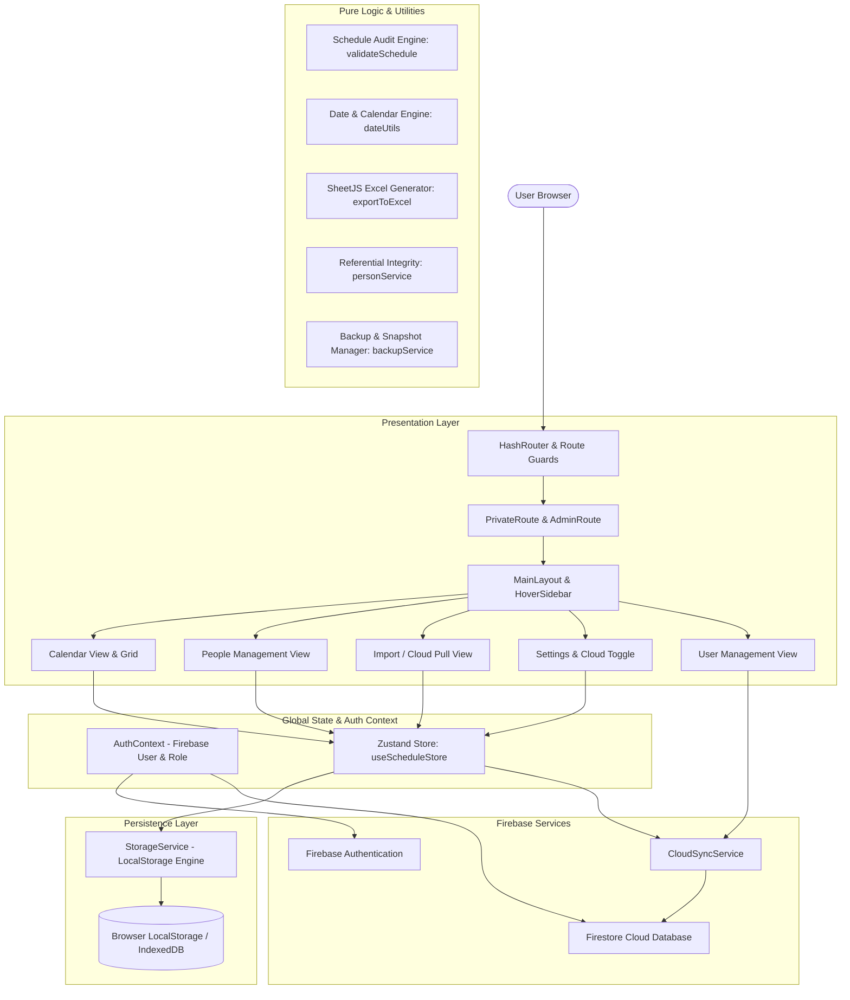

# HealthSchedule • Monthly Shift & On-Call Schedule Manager

[](https://github.com/pleaobraga/health-schedule/actions/workflows/deploy.yml)
[](https://pleaobraga.github.io/health-schedule/)
[](LICENSE)

> A modern, secure, and offline-first Monthly Shift and On-Call Schedule Manager designed for medical teams, clinics, emergency departments, and healthcare professionals. Built with **React 19**, **TypeScript**, **Tailwind CSS**, **Zustand**, and **Firebase (Auth & Firestore Sync)**.

🔗 **Live Application**: [https://pleaobraga.github.io/health-schedule/](https://pleaobraga.github.io/health-schedule/)

---

## 📋 Table of Contents

- [Overview](#-overview)
- [Key Features](#-key-features)
- [Authentication & Cloud Synchronization](#-authentication--cloud-synchronization)
- [Live Demo & Static Hosting](#-live-demo--static-hosting)
- [System Architecture](#-system-architecture)
- [Project Structure](#-project-structure)
- [Environment Variables](#-environment-variables)
- [Getting Started](#-getting-started)
  - [Prerequisites](#prerequisites)
  - [Installation](#installation)
  - [Development Server](#development-server)
  - [Production Build](#production-build)
- [Quality Assurance & Testing](#-quality-assurance--testing)
  - [Available Scripts](#available-scripts)
  - [Unit & Integration Tests](#unit--integration-tests)
  - [ESLint Flat Config & Code Quality](#eslint-flat-config--code-quality)
  - [Git Hooks & Automated Pre-Commit (Husky & lint-staged)](#git-hooks--automated-pre-commit-husky--lint-staged)
  - [Storybook Component Documentation](#storybook-component-documentation)
- [CI/CD & GitHub Actions](#-cicd--github-actions)
- [License](#-license)

---

## 🌟 Overview

**HealthSchedule** simplifies the complex task of organizing monthly shifts, on-call rosters, and medical schedules. It combines a clean calendar matrix with automated rule verification (preventing consecutive-day fatigue and excessive weekly shifts), referential integrity protection, data backup/recovery, multi-sheet Excel reports, and optional cloud synchronization powered by Firebase.

---

## 🚀 Key Features

### 📅 1. Interactive Monthly Calendar Grid

- **Sunday-to-Saturday Matrix**: Clean 7-column layout displaying the entire month with previous/next month days dimmed for continuous context.
- **Visual Today Highlight**: Today's date is immediately identified with a distinctive background tint.
- **Two Operating Modes**:
  - **Read-Only Mode**: Clean view of the final schedule with person tags, daily events, and warning badges.
  - **Edit Mode**: Allows instant addition and removal of staff from each day, candidate filtering by availability, and batch day insertion.
- **Unsaved Changes Shield**: Any attempt to leave edit mode without saving triggers an interactive guard modal prompting the user to save or discard changes.
- **Fullscreen Calendar Modal**: Expanded modal view for presentations, team displays, or multi-monitor workflows.

### 👥 2. Staff Management & Referential Integrity

- **Global Staff Registry**: Centralized management of healthcare staff with custom high-contrast color badges, full names, and activation statuses.
- **Referential Integrity & Soft Delete**:
  - If a professional has **any historical shifts** across recorded months, the system blocks permanent deletion to prevent orphan records. Instead, it guides the user to perform a **Safe Deactivation** (`active: false`).
  - Inactive professionals remain visible with distinct visual styles (reduced opacity, "Inactive" badge) and can be reactivated at any time.
  - Professionals with **zero historical allocations** can be permanently removed from the system.
- **Month-Specific Linking**: Isolate global staff into only the participants active for the selected month via `AddMonthParticipantsModal`.

### 🛡️ 3. Shift Compliance & Audit Engine

- **Consecutive Days Rule**: Prohibits assigning the same professional to consecutive days ($D$ and $D+1$), seamlessly validating across month boundaries (e.g., October 31st and November 1st).
- **Weekly Shift Limit**: Enforces a maximum allocation threshold (default: $\le 2$ shifts per Sunday-to-Saturday block), auditing across month transitions.
- **Conflict & Availability Checks**:
  - Flags days with more than one assigned professional (unresolved multi-allocation).
  - Flags days where an assigned professional has not registered availability.
  - Warns about unassigned empty days.
- **Audit Panel**: Instant diagnostic panel providing clear, actionable warnings and blocking errors.

### 📊 4. Advanced Multi-Sheet Excel Export (.xlsx)

Export the active month schedule with one click into a formatted spreadsheet containing 3 dedicated sheets:

1. **Detailed Daily Schedule**: Date, day of week, assigned professional, status, and custom notes.
2. **Summary by Professional**: Total shift count and specific days worked per team member.
3. **Panoramic Grid Matrix**: Full matrix cross-referencing all professionals against days 1 to $N$, with daily totals.

### 💾 5. Backup, Restore & Data Migration

- **JSON Snapshot Export**: One-click full database export (`escala_backup_YYYY-MM-DD_HHmm.json`).
- **Inspection & Conflict Prevention**: Preview backup contents before restoring, with confirmation modals preventing accidental data overwrite.
- **Onboarding Redirection**: If first opening the app with no local data, new users are automatically guided to import existing data or start fresh.
- **Admin Cloud Recovery**: Administrators can pull data saved on Firestore directly from the Import screen.

### 🌓 6. Ergonomics, Theme & Print System

- **Dark & Light Mode**: Fluid theme switching with persistent user preference and accessible contrast ratios.
- **Dark Theme Print Support**: Intelligent CSS media queries (`@media print`) ensure that schedules and event tables print with high-contrast, paper-optimized light backgrounds even when using dark theme.
- **Hover Sidebar (Desktop)**: Space-saving retractable drawer that smoothly expands on hover.
- **Mobile Friendly**: Dedicated top navigation bar and full-screen drawer menu for smartphones and tablets.

### 🛡️ 7. Fault Isolation & Error Boundaries

- **Component & Route Isolation**: Implements React 19 `ErrorBoundary` wrappers around main application views and route outlets.
- **Graceful Error Recovery**: Traps runtime exceptions to prevent full application crashes, providing users with actionable error messages and one-click reload/retry options.

---

## 🔐 Authentication & Cloud Synchronization

### 1. Mandatory Firebase Authentication

- **Secure Route Guards**: All internal routes are guarded by `PrivateRoute`. Users must authenticate with valid credentials via Firebase Auth.
- **Automatic Redirects**: Unauthenticated users are redirected to `#/login`. Authenticated users accessing `#/login` are sent to `#/calendario`.

### 2. Dynamic Role-Based Access Control (RBAC)

- **Zero Hardcoded Emails**: Role assignments (`admin` vs `user`) are stored dynamically in Firestore under the `users/{uid}` collection (`role: "admin"`).
- **Security Rules (`firestore.rules`)**:
  ```javascript
  function isAdmin() {
    return isAuthenticated() && (
      request.auth.token.admin == true ||
      request.auth.token.role == 'admin' ||
      (exists(/databases/$(database)/documents/users/$(request.auth.uid)) &&
       get(/databases/$(database)/documents/users/$(request.auth.uid)).data.role == 'admin')
    );
  }
  ```
- **Admin Protected Routes**: `AdminRoute` protects administrative sections like User Management (`#/usuarios`).

### 3. Cloud Synchronization (Firestore Spark Plan)

- **Local-First Architecture**: Default state reads and writes to browser local storage.
- **Admin Cloud Sync Toggle**: In `SettingsView`, administrators can turn on cloud synchronization. When active:
  - Monthly schedules are grouped into single documents per month (`schedules/{YYYY-MM}`).
  - Master staff updates (creation, deactivation, deletion) are synchronized to `schedules/_master_people`.
- **On-Demand Pull Button**: Administrators can explicitly pull remote cloud data into local storage from both the **Settings** and **Import** views.

### 4. Guest Mode & Multi-Profile Local Isolation ("Entrar como Convidado")

- **Instant Local Access**: Users can enter the system as guests directly from the login screen without network credentials.
- **Strict Non-Admin Role**: Guest accounts are assigned non-admin status (`role: 'user'`, `isAdmin: false`) and cannot access user administration routes or trigger Firestore cloud writes.
- **Multi-Guest Account Switcher**:
  - All guest accounts created on the device are remembered and listed in the Guest Access modal.
  - Users can select any existing profile to instantly resume work with their saved schedules and staff data.
  - Option to create a new guest profile with an arbitrary display name.
- **Isolated Local Datasets**: Each guest profile's data is isolated under scoped keys (`scale_manager_guest_data_v1_{id}`), ensuring complete data separation between different guest profiles.
- **Profile Deletion**: Obsolete guest profiles and their associated datasets can be removed with one click.

---

## 🌐 Live Demo & Static Hosting

The application is deployed as a static Single Page Application (SPA) on **GitHub Pages**:

- **URL**: [https://pleaobraga.github.io/health-schedule/](https://pleaobraga.github.io/health-schedule/)
- **Routing Strategy**: Built using `react-router-dom` with **`HashRouter`** (`#/login`, `#/calendario`, `#/pessoas`, `#/importar`, `#/configuracoes`, `#/usuarios`).
- **Dynamic Asset Base**: Configured with a relative base path (`./`) in `vite.config.ts`, ensuring all scripts, CSS, and fonts resolve accurately on sub-paths.

---

## 🏗️ System Architecture



### Core Technologies

| Area               | Library / Technology                                                                                                                      | Purpose                                                                        |
| :----------------- | :---------------------------------------------------------------------------------------------------------------------------------------- | :----------------------------------------------------------------------------- |
| **Framework**      | [React 19](https://react.dev/) + [TypeScript 5](https://www.typescriptlang.org/)                                                          | Component-based UI with strict end-to-end typing                               |
| **Build Tool**     | [Vite 8](https://vitejs.dev/)                                                                                                             | Sub-second HMR and manual chunk splitting (`react-vendor`, `firebase`, `xlsx`) |
| **Backend & Auth** | [Firebase 13](https://firebase.google.com/)                                                                                               | Authentication and Firestore Cloud DB synchronization                          |
| **Styling**        | [Tailwind CSS 3](https://tailwindcss.com/)                                                                                                | Modern utility-first CSS with dark theme support                               |
| **State**          | [Zustand 5](https://zustand.docs.pmnd.rs/)                                                                                                | Minimalist, reactive, decoupled global state management                        |
| **Routing**        | [React Router 7](https://reactrouter.com/)                                                                                                | Declarative client-side Hash routing (`createHashRouter`)                      |
| **Icons**          | [Lucide React](https://lucide.dev/)                                                                                                       | Lightweight, customizable SVG icons                                            |
| **Spreadsheets**   | [SheetJS (xlsx)](https://sheetjs.com/)                                                                                                    | Client-side Excel workbook and sheet generation                                |
| **Testing**        | [Vitest 5](https://vitest.dev/) + Testing Library                                                                                         | 29 test suites with 198 unit and integration tests                             |
| **Linter & Hooks** | [ESLint 10](https://eslint.org/) + [Husky](https://typicode.github.io/husky/) + [lint-staged](https://github.com/lint-staged/lint-staged) | Flat config, semicolon-free formatting, named exports, and pre-commit auto-fix |
| **Documentation**  | [Storybook 10](https://storybook.js.org/)                                                                                                 | Isolated stories for every UI component and modal                              |
| **CI/CD**          | [GitHub Actions](https://github.com/features/actions)                                                                                     | Automatic test validation and GitHub Pages deployment                          |

---

## 📁 Project Structure

The project strictly follows a modular, feature-based **kebab-case** naming standard for all directories and files:

```
src/
├── app.tsx                         # Root component with ErrorBoundary & context providers
├── main.tsx                        # Vite application bootstrap & DOM mounting
├── index.css                       # Global styles & Tailwind CSS directives
├── vite-env.d.ts                   # Vite environment definitions
├── components/                     # Reusable & domain-specific UI components
│   ├── auth/                       # Route guards (admin-route, private-route)
│   ├── calendar/                   # Monthly calendar grid, header, cells, candidate picker
│   ├── common/                     # Common components (error-boundary, etc.)
│   ├── import/                     # Import view & overwrite confirmation modals
│   ├── layout/                     # RootLayout and view wrappers
│   ├── modals/                     # Fullscreen calendar, day events, unsaved changes modals
│   ├── navigation/                 # HoverSidebar, top navigation bar
│   ├── people-management/          # Staff registry, deactivation & deletion modals
│   ├── settings/                   # System settings & cloud sync controls
│   ├── sidebar/                    # Monthly participants, availability mini-calendar
│   ├── users/                      # User administration & role management modals
│   └── validation/                 # Compliance audit panel
├── constants/                      # Application constants (tailwind-colors, etc.)
├── context/                        # React Context definitions (auth-context, auth-context-base)
├── hooks/                          # Custom React hooks (use-cloud-sync, etc.)
├── pages/                          # Top-level route pages (login-page, user-management-view)
├── router/                         # HashRouter configuration & route definitions
├── services/                       # Core services (backup, cloud-sync, firebase, person, storage)
├── store/                          # Zustand global store (use-schedule-store)
├── test/                           # Vitest setup & mocks
├── types/                          # Domain TypeScript types & interfaces
└── utils/                          # Pure utilities (validate-schedule, export-to-excel, date-utils, auth-errors)
```

---

## 🔑 Environment Variables

Create a `.env.local` file in the root directory for local development:

```env
VITE_FIREBASE_API_KEY=your_api_key_here
VITE_FIREBASE_AUTH_DOMAIN=your_project_id.firebaseapp.com
VITE_FIREBASE_PROJECT_ID=your_project_id
VITE_FIREBASE_STORAGE_BUCKET=your_project_id.firebasestorage.app
VITE_FIREBASE_MESSAGING_SENDER_ID=your_messaging_sender_id
VITE_FIREBASE_APP_ID=your_app_id
```

In GitHub Actions, configure these keys under **Settings > Secrets and variables > Actions > Repository secrets**.

---

## 🛠️ Getting Started

### Prerequisites

- **Node.js**: `>= v24.22.0`
- **Package Manager**: [pnpm](https://pnpm.io/) (`>= 12.14.0`)

### Installation

Clone the repository and install all project dependencies:

```bash
git clone https://github.com/pleaobraga/health-scale.git
cd health-scale
pnpm install
```

### Development Server

Start the local development server with Hot Module Replacement (HMR):

```bash
pnpm dev
```

The app will be accessible at `http://localhost:5173`.

### Production Build

Generate an optimized, minified production build:

```bash
pnpm build
```

Preview the production build locally:

```bash
pnpm preview
```

---

## 🧪 Quality Assurance & Testing

### Available Scripts

```bash
# Typecheck TypeScript code with no emit
pnpm typecheck

# Lint all TypeScript and React files with ESLint
pnpm lint

# Automatically fix linting and formatting issues
pnpm lint:fix

# Run all unit and integration tests in headless mode
pnpm test:run

# Run tests in interactive watch mode
pnpm test

# Run full validation pipeline (typecheck + lint + test:run)
pnpm validate

# Launch Storybook development workshop
pnpm storybook

# Build static Storybook documentation
pnpm build-storybook
```

### Unit & Integration Tests

The project features a comprehensive test suite covering utilities, services, stores, route guards, and React components using **Vitest** and **React Testing Library**:

```bash
pnpm test:run
```

_Current test metrics: **29 test files, 198 tests passing** (100% pass rate)._

### ESLint Flat Config & Code Quality

Configured in `eslint.config.js` using the modern ESLint Flat Config format:

- **Semicolon-Free Syntax**: Standardizes modern, clean JavaScript syntax (`semi: ['error', 'never']`).
- **Mandatory Named Exports**: Disallows `export default` in application source files (`import/no-default-export: 'error'`), enforcing consistent naming across imports and refactoring safety (with explicit overrides for Storybook stories and configuration files).
- **Import Ordering & Grouping**: Deterministic organization of external, internal, and sibling modules (`import/order`).
- **Consistent Type Imports**: Enforces `import type` for type-only imports (`@typescript-eslint/consistent-type-imports`).
- **Storybook Linting**: Dedicated validation for component stories (`eslint-plugin-storybook`).

### Git Hooks & Automated Pre-Commit (Husky & lint-staged)

The repository enforces code quality automatically via Git hooks managed by **Husky**:

- **Pre-Commit Hook (`.husky/pre-commit`)**: Triggers `pnpm lint-staged` on every commit, automatically running `eslint --fix` solely on staged `.{ts,tsx,js,jsx}` files before allowing the commit to proceed.
- **Pre-Push Hook (`.husky/pre-push`)**: Executes the complete quality validation pipeline (`pnpm typecheck`, `pnpm lint`, and `pnpm test:run`) before any push to remote branches, preventing broken builds or regressions.

### Storybook Component Documentation

Component development and UI states are documented in isolation using **Storybook 10**:

- Comprehensive story coverage for all modals (Day Events, Unsaved Changes, Confirm Overwrite, Availability, Fullscreen Calendar).
- Interactive parameter and argTypes exploration for calendar cells, cards, and navigation bars.
- Test stories verify visual states under both light and dark themes.

---

## 🔄 CI/CD & GitHub Actions

The project includes an automated deployment pipeline via GitHub Actions (`.github/workflows/deploy.yml`):

- **Trigger**: Every push to the `main` branch.
- **Workflow Pipeline**:
  1. Checks out repository.
  2. Sets up Node.js with `pnpm` caching.
  3. Installs dependencies (`pnpm install --frozen-lockfile`).
  4. Runs TypeScript typechecking (`pnpm typecheck`).
  5. Runs ESLint code style and quality validation (`pnpm lint`).
  6. Executes Vitest automated test suite (`pnpm test:run`) with injected secrets and test fallbacks.
  7. Builds optimized production distribution (`pnpm build`).
  8. Deploys the `./dist` folder to **GitHub Pages**.

---

## 📄 License

This project is open-source and released under the [MIT License](LICENSE).
