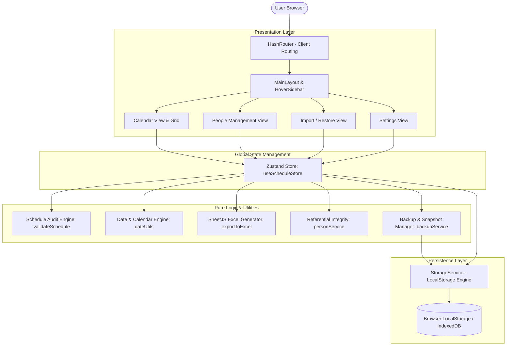

# HealthSchedule • Monthly Shift & On-Call Schedule Manager

[](https://github.com/pleaobraga/health-scale/actions/workflows/deploy.yml)
[](https://pleaobraga.github.io/health-scale/)
[](LICENSE)

> A modern, 100% client-side Monthly Shift and On-Call Schedule Manager designed for medical teams, clinics, emergency departments, and healthcare professionals. Built with **React 19**, **TypeScript**, **Tailwind CSS**, and **Zustand**.

🔗 **Live Application**: [https://pleaobraga.github.io/health-scale/](https://pleaobraga.github.io/health-scale/)

---

## 📋 Table of Contents

- [Overview](#-overview)
- [Key Features](#-key-features)
- [Live Demo & Static Hosting](#-live-demo--static-hosting)
- [System Architecture](#-system-architecture)
- [Project Structure](#-project-structure)
- [Getting Started](#-getting-started)
  - [Prerequisites](#prerequisites)
  - [Installation](#installation)
  - [Development Server](#development-server)
  - [Production Build](#production-build)
- [Quality Assurance & Testing](#-quality-assurance--testing)
  - [Unit & Integration Tests](#unit--integration-tests)
  - [Storybook](#storybook)
  - [Husky Pre-Push Pipeline](#husky-pre-push-pipeline)
- [CI/CD & GitHub Actions](#-cicd--github-actions)
- [Data Security & Privacy](#-data-security--privacy)
- [License](#-license)

---

## 🌟 Overview

**HealthSchedule** simplifies the complex task of organizing monthly shifts, on-call rosters, and medical schedules. It combines a clean calendar matrix with automated rule verification (preventing consecutive-day fatigue and excessive weekly shifts), referential integrity protection, data backup/recovery, and multi-sheet Excel reports.

Because it runs entirely client-side with local browser persistence (`localStorage` / IndexedDB), sensitive medical scheduling data never leaves the user's browser, guaranteeing complete privacy and zero hosting overhead.

---

## 🚀 Key Features

### 📅 1. Interactive Monthly Calendar Grid
- **Sunday-to-Saturday Matrix**: Clean 7-column layout displaying the entire month with previous/next month days dimmed for continuous context.
- **Visual Today Highlight**: Today's date is immediately identified with a distinctive background tint.
- **Two Operating Modes**:
  - **Read-Only Mode**: Clean view of the final schedule with person tags, daily events, and warning badges.
  - **Edit Mode**: Allows instant addition and removal of staff from each day, candidate filtering by availability, and batch day insertion.
- **Unsaved Changes Shield**: Any attempt to leave edit mode without saving triggers an interactive guard modal prompting the user to save or discard changes.
- **Fullscreen Calendar Modal**: Expanded modal view for presentations, team displays, or multi-monitor workflows.

### 👥 2. Staff Management & Referential Integrity
- **Global Staff Registry**: Centralized management of healthcare staff with custom high-contrast color badges, full names, and activation statuses.
- **Referential Integrity & Soft Delete**:
  - If a professional has **any historical shifts** across recorded months, the system blocks permanent deletion to prevent orphan records and historical gaps. Instead, it intercepts the deletion request and guides the user to perform a **Safe Deactivation** (`active: false`).
  - Inactive professionals remain visible with distinct visual styles (reduced opacity, "Inactive" badge) and can be reactivated at any time.
  - Professionals with **zero historical allocations** can be permanently removed from the system.
- **Month-Specific Linking**: Isolate global staff into only the participants active for the selected month.

### 🛡️ 3. Shift Compliance & Audit Engine
- **Consecutive Days Rule**: Prohibits assigning the same professional to consecutive days ($D$ and $D+1$), seamlessly validating across month boundaries (e.g., October 31st and November 1st).
- **Weekly Shift Limit**: Enforces a maximum allocation threshold (default: $\le 2$ shifts per Sunday-to-Saturday block), auditing across month transitions.
- **Conflict & Availability Checks**:
  - Flags days with more than one assigned professional (unresolved multi-allocation).
  - Flags days where an assigned professional has not registered availability.
  - Warns about unassigned empty days.
- **Audit Panel**: Instant diagnostic panel providing clear, actionable warnings and blocking errors.

### 📊 4. Advanced Multi-Sheet Excel Export (.xlsx)
Export the active month schedule with one click into a formatted spreadsheet containing 3 dedicated sheets:
1. **Detailed Daily Schedule**: Date, day of week, assigned professional, status, and custom notes.
2. **Summary by Professional**: Total shift count and specific days worked per team member.
3. **Panoramic Grid Matrix**: Full matrix cross-referencing all professionals against days 1 to $N$, with daily totals.

### 💾 5. Backup, Restore & Data Migration
- **JSON Snapshot Export**: One-click full database export (`escala_backup_YYYY-MM-DD_HHmm.json`).
- **Inspection & Conflict Prevention**: Preview backup contents before restoring, with confirmation modals preventing accidental data overwrite.
- **Onboarding Redirection**: If first opening the app with no local data, new users are automatically guided to import existing data or start fresh.

### 🌓 6. Ergonomics & Responsive UI
- **Dark & Light Mode**: Fluid theme switching with persistent user preference.
- **Hover Sidebar (Desktop)**: Space-saving retractable drawer that smoothly expands on hover.
- **Mobile Friendly**: Dedicated top navigation bar and full-screen drawer menu for smartphones and tablets.

---

## 🌐 Live Demo & Static Hosting

The application is deployed as a static Single Page Application (SPA) on **GitHub Pages**:

- **URL**: [https://pleaobraga.github.io/health-scale/](https://pleaobraga.github.io/health-scale/)
- **Routing Strategy**: Built using `react-router-dom` with **`HashRouter`** (`/#/` and `/#/pessoas`). This guarantees that page reloads (F5), deep links, and shared URLs never trigger 404 errors on static hosts like GitHub Pages, S3, or Nginx.
- **Dynamic Asset Base**: Configured with a relative base path (`./`) in `vite.config.ts`, ensuring all scripts, CSS, and fonts resolve accurately whether hosted at the domain root or inside a sub-repository path.

---

## 🏗️ System Architecture



### Core Technologies
| Area | Library / Technology | Purpose |
| :--- | :--- | :--- |
| **Framework** | [React 19](https://react.dev/) + [TypeScript 5](https://www.typescriptlang.org/) | Component-based UI with strict end-to-end typing |
| **Build Tool** | [Vite 8](https://vitejs.dev/) | Sub-second HMR and optimized production bundles |
| **Styling** | [Tailwind CSS 3](https://tailwindcss.com/) | Modern utility-first CSS with dark theme support |
| **State** | [Zustand 5](https://zustand.docs.pmnd.rs/) | Minimalist, reactive, decoupled global state management |
| **Routing** | [React Router 7](https://reactrouter.com/) | Declarative client-side Hash routing (`createHashRouter`) |
| **Icons** | [Lucide React](https://lucide.dev/) | Lightweight, customizable SVG icons |
| **Spreadsheets** | [SheetJS (xlsx)](https://sheetjs.com/) | Client-side Excel workbook and sheet generation |
| **Testing** | [Vitest 5](https://vitest.dev/) + Testing Library | Blazing fast unit and integration test runner |
| **Component Workshop** | [Storybook 8](https://storybook.js.org/) | Isolated UI development and component catalog |
| **Git Hooks** | [Husky](https://typicode.github.io/husky/) | Automated local pre-push validation gate |
| **CI/CD** | [GitHub Actions](https://github.com/features/actions) | Automatic test validation and GitHub Pages deployment |

---

## 📁 Project Structure

```text
health-scale/
├── .github/
│   └── workflows/
│       └── deploy.yml          # GitHub Actions CI/CD pipeline for GitHub Pages
├── .husky/
│   └── pre-push                # Git pre-push hook: typecheck -> lint -> tests
├── public/
│   ├── 404.html                # Static hosting fallback redirector
│   └── favicon.svg             # Application icon
├── src/
│   ├── components/             # UI Components
│   │   ├── Calendar/           # Calendar grid, header, cells, picker
│   │   ├── Import/             # Data backup upload, preview, overwrite modal
│   │   ├── Layout/             # Main layout shell with Outlet
│   │   ├── Modals/             # Events, full-screen calendar, unsaved warnings
│   │   ├── Navigation/         # Responsive HoverSidebar and mobile drawer
│   │   ├── PeopleManagement/   # Master staff registry, cards, modals
│   │   ├── Settings/           # Preferences, theme toggling, storage stats
│   │   ├── Sidebar/            # Monthly participants, availability mini-calendar
│   │   └── Validation/         # Schedule audit & compliance status panel
│   ├── constants/
│   │   └── tailwindColors.ts   # Curated accessible color palette
│   ├── router/
│   │   ├── index.tsx           # HashRouter declaration and navigation guards
│   │   └── routeConfig.ts      # Route path constants
│   ├── services/
│   │   ├── backupService.ts    # JSON snapshot export/import validation
│   │   ├── personService.ts    # Referential integrity & soft-delete checks
│   │   └── storageService.ts   # LocalStorage persistence adapter
│   ├── store/
│   │   └── useScheduleStore.ts # Central Zustand state store
│   ├── types/
│   │   └── index.ts            # Domain entity interfaces & TypeScript models
│   ├── utils/
│   │   ├── dateUtils.ts        # Date manipulation & calendar grid algorithms
│   │   ├── exportToExcel.ts    # SheetJS workbook generation logic
│   │   └── validateSchedule.ts # Pure schedule validation & audit engine
│   ├── App.tsx                 # Root application wrapper
│   └── main.tsx                # Entry point
├── index.html                  # HTML entry template
├── package.json                # Project dependencies and script declarations
├── tailwind.config.js          # Tailwind CSS layout and color extensions
├── tsconfig.json               # Strict TypeScript configuration
└── vite.config.ts              # Vite build setup with Vitest configuration
```

---

## 🛠️ Getting Started

### Prerequisites
- **Node.js**: `v18.0.0` or higher
- **Package Manager**: [pnpm](https://pnpm.io/) (`>= 8.0.0` recommended)

### Installation
Clone the repository and install all project dependencies:
```bash
git clone https://github.com/pleaobraga/health-scale.git
cd health-scale
pnpm install
```

### Development Server
Start the local development server with Hot Module Replacement (HMR):
```bash
pnpm dev
```
The app will be accessible at `http://localhost:5173`.

### Production Build
Generate an optimized, minified production build:
```bash
pnpm build
```
Preview the production build locally:
```bash
pnpm preview
```

---

## 🧪 Quality Assurance & Testing

The repository enforces strict code quality standards, type safety, and test coverage.

### Available Scripts
```bash
# Typecheck TypeScript code with no emit
pnpm typecheck

# Lint all TypeScript and React files with ESLint
pnpm lint

# Run all unit and integration tests in headless mode
pnpm test:run

# Run full validation pipeline (typecheck + lint + test:run)
pnpm validate
```

### Unit & Integration Tests
The project features a comprehensive test suite covering utilities, services, stores, and React components using **Vitest** and **React Testing Library**:
```bash
pnpm test
```
Test files reside alongside their source components (e.g., `dateUtils.test.ts`, `validateSchedule.test.ts`, `useScheduleStore.test.ts`, `router.test.tsx`).

### Storybook
Storybook is configured for developing and previewing UI components in isolation:
```bash
# Launch Storybook development server on http://localhost:6006
pnpm storybook

# Build static Storybook documentation bundle
pnpm build-storybook
```

### Husky Pre-Push Pipeline
Whenever you run `git push`, the pre-push hook (`.husky/pre-push`) automatically intercepts the command and executes:
1. `pnpm typecheck` (tsc --noEmit)
2. `pnpm lint` (ESLint)
3. `pnpm test:run` (Vitest headless suite)

If any check fails, the push is immediately cancelled, ensuring broken code is never published to the remote repository.

---

## 🔄 CI/CD & GitHub Actions

The project includes a production-ready automated deployment pipeline via GitHub Actions (`.github/workflows/deploy.yml`):

- **Trigger**: Every push to the `main` branch.
- **Workflow Steps**:
  1. Clones the repository.
  2. Sets up Node.js with `pnpm` caching.
  3. Installs dependencies (`pnpm install --frozen-lockfile`).
  4. Runs the complete validation suite (`pnpm validate`).
  5. Generates the production build (`pnpm build`).
  6. Publishes the `dist/` directory to **GitHub Pages** using GitHub's native ephemeral `GITHUB_TOKEN`.
- **Zero Token Setup**: Does not require manual secrets, Personal Access Tokens (PAT), or external integrations.

---

## 🔒 Data Security & Privacy

- **100% Client-Side**: No backend servers, external databases, or third-party analytical trackers are contacted.
- **Offline First**: All schedule data and configurations reside locally in the user's browser.
- **Data Sovereignty**: The user maintains complete control over their data via the JSON export and import functionalities.

---

## 📄 License

This project is open-source and released under the [MIT License](LICENSE).

