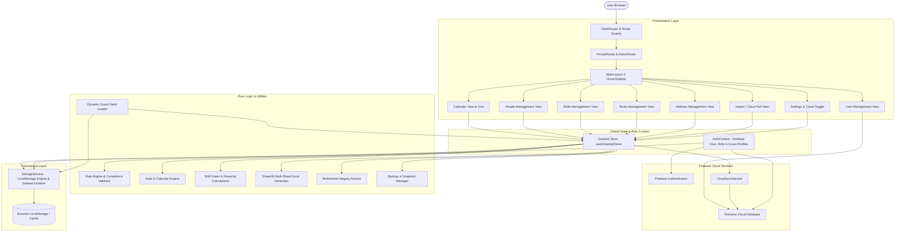

# HealthSchedule • Monthly Shift & On-Call Schedule Manager

[](https://github.com/pleaobraga/health-schedule/actions/workflows/deploy.yml)
[](https://pleaobraga.github.io/health-schedule/)
[](LICENSE)

> A modern, offline-first Monthly Shift and On-Call Schedule Manager for healthcare teams, clinics, and emergency departments. Built with **React 19**, **TypeScript**, **Tailwind CSS**, **Zustand**, and **Firebase**.

🔗 **Live Demo**: [https://pleaobraga.github.io/health-schedule/](https://pleaobraga.github.io/health-schedule/)

---

## 🌟 Overview & Key Features

HealthSchedule streamlines the complexity of medical roster planning through an intuitive calendar interface, real-time labor compliance auditing, and flexible shift pricing.

- 📅 **Interactive Schedule Calendar**: Monthly grid with instant day allocations, candidate availability filters, unsaved changes protection, and high-contrast print-optimized export.
- ⚙️ **Custom Shifts & Dynamic Rule Engine**: Define customizable shifts (12h, 24h, custom hours) with real-time compliance auditing (consecutive day limits, minimum rest, maximum weekly/monthly hours).
- 💰 **Shift Rates & Financial Reports**: Configure base and surge rates per professional/day (weekends, holidays) and generate instant monthly payment summaries.
- 👥 **Staff Registry & Referential Integrity**: Centralized staff management with custom color coding and soft-delete protection for historical allocations.
- 💾 **Offline-First & Multi-Profile Guest Mode**: Works 100% offline via browser storage with instant dynamic demo seed data; supports multi-profile guest accounts and optional Firebase Cloud Sync for administrators.
- 📊 **Export & Data Portability**: Multi-sheet formatted Excel reports (`.xlsx`), JSON snapshot backups, and cloud recovery.
- 🌐 **Bilingual (i18n) & Dark Theme**: Full native support for Brazilian Portuguese (`pt-BR`) and English (`en-US`), with system/manual dark mode toggling.

---

## 🛠️ Tech Stack

| Layer | Technologies |
| :--- | :--- |
| **Frontend** | React 19, TypeScript, Tailwind CSS, Lucide Icons |
| **State & Storage** | Zustand, Browser LocalStorage / IndexedDB |
| **Cloud & Auth** | Firebase 13 (Auth, Firestore Cloud Sync) |
| **Reporting & i18n** | SheetJS (XLSX), i18next & react-i18next |
| **Quality & Tests** | Vitest, React Testing Library, ESLint, Husky, Storybook 10 |

---

## 🏗️ System Architecture



---

## 🚀 Quick Start

### Prerequisites

- **Node.js**: `>= 24.22.0`
- **pnpm**: `>= 12.14.0`

### Setup

```bash
# Clone repository
git clone https://github.com/pleaobraga/health-scale.git
cd health-schedule

# Install dependencies
pnpm install

# Start development server
pnpm dev
```

The app will be available at `http://localhost:5173`.

### Environment Configuration

For Firebase authentication and cloud synchronization, create a `.env.local` file:

```env
VITE_FIREBASE_API_KEY=your_api_key
VITE_FIREBASE_AUTH_DOMAIN=your_project.firebaseapp.com
VITE_FIREBASE_PROJECT_ID=your_project_id
VITE_FIREBASE_STORAGE_BUCKET=your_project.firebasestorage.app
VITE_FIREBASE_MESSAGING_SENDER_ID=your_sender_id
VITE_FIREBASE_APP_ID=your_app_id
```

_(Note: The app runs in complete offline/guest mode even without Firebase credentials)._

---

## 🧪 Available Scripts

| Command          | Description                                                 |
| :--------------- | :---------------------------------------------------------- |
| `pnpm dev`       | Starts Vite development server with HMR                     |
| `pnpm build`     | Compiles TypeScript and creates optimized production bundle |
| `pnpm test`      | Runs unit and integration tests with Vitest                 |
| `pnpm test:run`  | Executes tests once in headless mode                        |
| `pnpm lint`      | Runs ESLint flat config validation                          |
| `pnpm lint:fix`  | Automatically fixes linting and formatting issues           |
| `pnpm typecheck` | Validates TypeScript types across the codebase              |
| `pnpm validate`  | Full pipeline: typecheck + lint + test:run                  |
| `pnpm storybook` | Starts Storybook component workshop                         |

---

## 📄 License

This project is licensed under the [MIT License](LICENSE).
